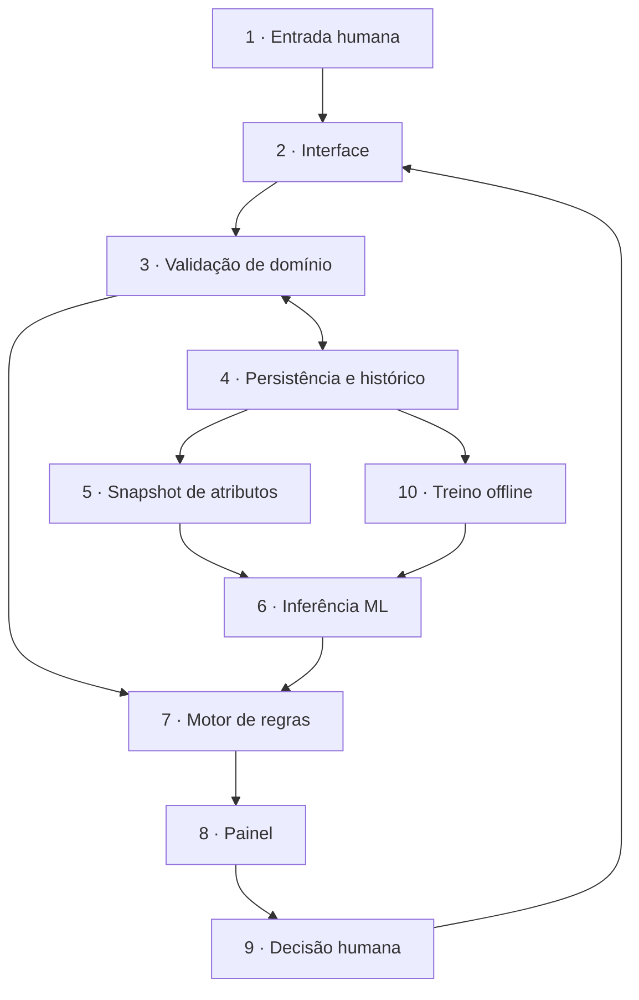

# Relatório técnico — Gestão de Marcas

## Problema e status da entrega

Organizar a fila de providências de marcas a partir de datas conferidas e informações do responsável. O componente lógico decide a prioridade; o ML estima a chance de a providência não ser concluída no prazo, no instante da primeira validação humana (t0).

O Marco 2 era uma proposta de arquitetura, com 19 processos previstos e sem dataset rotulado ou experimentos comprovados no tema atual. O Marco Final implementa um **protótipo acadêmico independente** em Python/Streamlit. Dados, nomes de processos e rótulos são **sintéticos**. Não há evidência de eficácia jurídica ou operacional.

## Arquitetura e módulos

O desenho conceitual do Marco 2 contém dez módulos. O fluxo abaixo preserva as relações; as funções de API, persistência e autenticação são simplificadas no MVP.



| Módulos do Marco 2 | Realização neste MVP |
|---|---|
| 1, 3, 4 | Cenários em objetos/CSV; validação tipada; arquivos locais; auditoria de revisão na sessão |
| 2, 8 | Streamlit, sem login; tabela, parâmetros e inspeção |
| 5 | Snapshot t0 preservado; atributos selecionados explicitamente |
| 6 | Pipeline scikit-learn carregado e `predict_proba` |
| 7 | Fatos, regras de produção, agenda e ponto fixo |
| 9 | Confirmação humana simulada; registro com autoria demonstrativa |
| 10 | Treino offline versionado com manifesto, métricas e predições |

## Representação e inferência de IA

`Fact` representa uma proposição derivável e seu valor. A memória de trabalho inicia com conclusão, dias restantes, ausência e status do ML; o contrato válido acrescenta `risco_ml`. `Rule` contém condição, efeitos e identificador. A agenda seleciona regras habilitadas, cada uma disparando uma vez; os efeitos entram na memória e habilitam o ciclo seguinte. A execução termina no ponto fixo. Só então a resolução escolhe o candidato de maior precedência.

Exemplo real da demo: a regra R2 deriva `prazo_aberto`; R6 usa o risco 0.824111 calculado pelo modelo e deriva um motivo; R7 usa esse motivo em um ciclo posterior e deriva `candidato_ALTO`. O painel mostra memória inicial/final, fatos consultados, efeitos, ciclos e resolução. Não há apenas uma classificação opaca.

| Condição | Prioridade |
|---|---|
| Concluído | FORA_DA_FILA |
| Aberto e dias < 0 | VENCIDO |
| Aberto e 0 ≤ dias ≤ margem | URGENTE |
| Aberto fora da margem e ausência ou risco ≥ limiar | ALTO |
| Demais abertos | NORMAL |

A ausência e o risco podem aparecer como motivos adicionais mesmo em vencidos/urgentes; a precedência permanece intacta. Em concluídos, as regras de ação não disparam. O limiar padrão 0,70 e a margem de cinco dias são configurações ilustrativas, sem aprovação jurídica presumida. Datas-limite permanecem imutáveis.

Regras foram escolhidas pela rastreabilidade e precedência. CSP seria adequado a alocação sob restrições, fora do objetivo atual. Uma rede bayesiana exigiria estrutura e probabilidades condicionais sem suporte no material disponível.

## Dados e rótulo

Gerador: `src/data/synthetic.py`, seed 20261117, 1.200 processos com três prazos cada. Datas t0 simuladas de 2019 a 2025, com intervalo entre processos. Dias restantes variam de 1 a 35; carga de 0 a 60; ausência t0 tem probabilidade de 16%; quatro tipos de ato.

O gerador calcula uma probabilidade latente logística: `z = -2.6 - 0.07*dias + 0.065*carga + ausencia + efeito_ato + efeito_processo + ruido`. Efeito de processo segue Normal(0, 0,5); ruído segue Normal(0, 0,6). Os efeitos de ato são 0,9 para exigência, 0,4 manifestação, 0,1 pagamento e -0,3 acompanhamento. O rótulo nasce de Bernoulli(sigmoid(z)); depois são criadas datas de conclusão consistentes com y. Esses números são hipóteses de simulação, sem estimativa empírica do domínio.

`y=1` corresponde a conclusão posterior à data-limite; `y=0` a conclusão até a data-limite. Todos os exemplos gerados têm desfecho maduro. A base real futura também precisaria tratar abertos vencidos, cancelamentos e casos indeterminados; este gerador simula somente conclusões conhecidas.

Features: `dias_restantes_t0, carga_prazos_abertos_responsavel_t0, responsavel_ausente_t0, tipo_ato, situacao_t0`. `situacao_t0` é constante ABERTO nesta simulação; não agrega sinal, mas mantém o campo de contrato. A prioridade operacional prévia é omitida por não existir histórico independente. Identificadores, conclusão, maturidade do desfecho e y ficam fora das features.

Os sete cenários da interface são separados dos exemplos de treino, usam IDs DEMO e não foram usados para seleção de limiar ou ajuste de modelo. Uma data de referência posterior a t0 só muda regras; a previsão continua sendo a original de t0.

## Particionamento e prevenção de vazamento

Processos ordenados pelo primeiro t0: 60% dos grupos candidatos a treino, 20% validação e 20% teste. Nenhum processo atravessa partições. A purga elimina do treino os exemplos cujo desfecho ainda não estaria disponível antes da validação, e da validação aqueles não maduros antes do teste: 27 e 33 exclusões, respectivamente.

| Partição | Prazos | Processos após purga | Classe 0 | Classe 1 | Intervalo t0 |
|---|---:|---:|---:|---:|---|
| treino | 2133 | 716 | 1543 | 590 | 2019-01-01 a 2022-12-03 |
| validacao | 687 | 235 | 516 | 171 | 2022-12-11 a 2024-03-29 |
| teste | 720 | 240 | 494 | 226 | 2024-04-04 a 2025-07-28 |

Pipeline: imputação mediana e StandardScaler para números; imputação por moda e OneHotEncoder com categorias desconhecidas ignoradas para categorias; LogisticRegression regularizada L2, C=1, max_iter=1000. Os transformadores são ajustados apenas no treino. Não há dados ausentes no gerador atual; a inferência exige todos os campos mínimos, caso contrário usa fallback.

## Seleção e avaliação

Comparação implementada: Dummy majoritário e regressão logística. Árvore, Random Forest e HistGradientBoosting permanecem candidatos futuros; não foram treinados nesta entrega. A regressão foi uma escolha arquitetural simples fixada antes da avaliação do teste. Não houve busca de hiperparâmetros nem promoção para produção.

O limiar **0.25** foi escolhido somente na validação, maximizando F2 sob um orçamento ilustrativo de até 45% de alertas. Não representa capacidade real da equipe. O teste permaneceu fora desse ajuste; nele a fração de alertas foi 46.9%, mostrando que o orçamento de validação não garante a mesma carga em períodos posteriores.

| Modelo no teste sintético | Precision | Recall | F1 | AP | Brier |
|---|---:|---:|---:|---:|---:|
| dummy_majoritario | não calculável | 0.0% | 0.0000 | 0.3139 | 0.3139 |
| regressao_logistica | 51.2% | 76.5% | 0.6135 | 0.6715 | 0.1624 |

Precision do Dummy é não calculável porque ele não prevê positivos; recall e F1 são calculáveis e iguais a zero. AP do Dummy coincide com a prevalência do teste (31.4%). AP usa `average_precision_score`, sem interpolação trapezoidal. O Brier menor favorece a regressão neste experimento, mas não constitui validação de calibração real. Cinco faixas de calibração por quantis estão no JSON; não houve recalibração nem intervalo de confiança nesta versão.

Matriz de confusão da regressão no limiar 0.25: **TN=329, FP=165, FN=53, TP=173**. Precision=TP/(TP+FP); recall=TP/(TP+FN); F1=2TP/(2TP+FP+FN). Há 226 atrasos e 494 conclusões pontuais no teste de 720 exemplos.

O painel inicia com **0,70**, para reproduzir o exemplo operacional do Marco 2. Nesse limiar a regressão atinge precision 90.5%, recall 16.8% e F1 0.2836. Aumentar o limiar reduz alarmes e perde atrasos. As métricas principais da tabela acima pertencem ao limiar 0,25.

## Regras versus integração

Comparação técnica no snapshot t0 do teste, com alerta definido como URGENTE ou ALTO: regras isoladas (margem 5 ou ausência) versus as mesmas regras acrescidas de ML ≥ 0,25. A rotina usa as condições equivalentes às regras para snapshots abertos, com dias ≥ 1; não avalia uma simulação longitudinal de intervenções.

| Modo | Recall | Precision | Alertas | Falsos positivos |
|---|---:|---:|---:|---:|
| Regras | 44.2% | 48.5% | 28.6% | 106 |
| Regras + ML | 84.5% | 46.9% | 56.5% | 216 |

O experimento detecta mais rótulos sintéticos de atraso e também aumenta trabalho de revisão e alarmes falsos. Não demonstra que a equipe evitaria atrasos, nem justifica adoção operacional. O gerador favorece relações compatíveis com a logística, o que limita a comparação e precisa ser dito à banca.

## Integração e fallback

Contrato real salvo em `docs/demo_ml.json`; exemplo executado:

```json
{
  "schema_version": "1.0",
  "prazo_id": "D04-RISCO",
  "gerado_em": "2026-11-17T10:58:33.520893+00:00",
  "modelo_versao": "logreg-sintetica-v1-6fd088eae9",
  "status": "ok",
  "prob_atraso": 0.8241107932764514
}
```

O carregador verifica hash, versão de scikit-learn, origem e features do artefato local. `status=ok` só nasce de `predict_proba` com bundle carregado. O validador rejeita probabilidades fora do intervalo, NaN/infinito, booleanos, status contraditórios, identificador incorreto, versão ausente e timestamp sem timezone. Erros viram indisponibilidade com probabilidade nula; o motor usa fatos operacionais. Regras recebem probabilidades controladas apenas em testes unitários, separados da integração real.

Modelo: `logreg-sintetica-v1-6fd088eae9`. Dataset SHA-256: `6fd088eae9f4f6727b6fce92de9fce0fb2f9c94f4d195e912f4522b06653cd30`. Versões e hash do artefato estão em `models/manifesto.json`; cada classificação registra referência, data-limite, parâmetros, versão, motivos e timestamp de inferência.

## Evidências, limitações e próximos passos

### Aba de gráficos — atualização de 17/11/2026

O Streamlit organiza o painel existente na aba **Análise de prazos** e acrescenta **Gráficos**, usando os mesmos resultados de inferência da sessão. A nova aba apresenta contagens por prioridade na ordem VENCIDO, URGENTE, ALTO e NORMAL; dias restantes por prazo aberto; e probabilidades de atraso em t0 convertidas para porcentagem. Concluídos são excluídos dos gráficos da fila e contabilizados separadamente. Não há previsão de risco diário: alterar a referência atualiza as regras e os dias restantes, preservando o snapshot de ML.

O gráfico de risco usa somente contratos com status `ok` e probabilidade disponível; valores ausentes não são substituídos por zero. Modo sem ML, artefato ausente e fila totalmente concluída têm mensagens específicas. Todos os dados permanecem identificados como sintéticos.

Verificação desta alteração: `python -m pytest -q --basetemp=output/pytest-graficos-final -o cache_dir=output/pytest-cache-graficos` — **65 testes passaram em 3,88 s**. Log: `output/pytest-graficos.txt`. O AppTest verifica contagens, correspondência das probabilidades com a tabela, exclusão de concluídos, conclusão/restauração, mudança de referência, ausência de ML e fila vazia. A pasta temporária foi colocada no projeto devido à restrição de acesso à pasta temporária padrão do Windows. A inspeção visual em navegador **não foi verificada**, pois o host de acesso ao navegador estava indisponível.

Os logs e resultados reais ficam em `RESULTADOS_EXECUCAO.md`, `pytest_stdout.txt`, `treino_stdout.json`, `metricas.json`, `predicoes_teste_sintetico.csv`, `particoes.csv` e os dois JSON de demonstração. O painel permite registrar e baixar uma revisão simulada; não há homologação externa.

Limites: sem histórico real; gerador conhecido e pouco representativo; ausência de validação jurídica; baixa portabilidade entre versões de artefato; sem autenticação e persistência multiusuário; falta de estimativa de incerteza por grupos; ausência de atualização diária do risco. Erros humanos na conferência podem comprometer toda a fila.

Próximos passos: coletar snapshots e desfechos reais com governança; validar maturidade e correlação por processo; avaliar em período posterior e recalibrar; escolher margem e limiar com capacidade da equipe; avaliar benefício sobre regras isoladas; só então projetar integração com WebSystem.

## Referências

- Marco 2 preenchido: `Marco2_Documento_Padrao_Entrega-1.docx` (arquitetura e integração propostas).
- Roteiro final: `Marco3_Documento_Roteiro_e_Avaliacao (1).docx` (demonstração real e cinco critérios).
- Catálogo de PI e modelos de entrega, usados como requisitos acadêmicos.
- [scikit-learn — prevenção de vazamento e pipelines](https://scikit-learn.org/stable/common_pitfalls.html).
- [Streamlit — AppTest](https://docs.streamlit.io/develop/api-reference/app-testing/st.testing.v1.apptest).

O Marco 1 de entregas/Olist é apenas histórico do tema abandonado; seus dados e resultados não foram usados.
